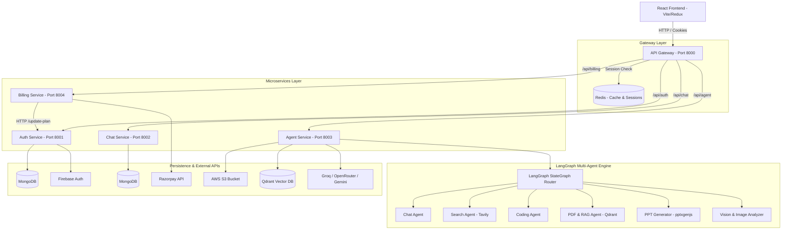

# CortexAI - Multi-Agent AI Platform


**CortexAI** is an enterprise-grade, multi-agent AI platform built using a modern microservices architecture. It features a centralized API Gateway, stateful multi-agent orchestration via **LangGraph**, credit-based billing integration with **Razorpay**, multi-provider LLM support (Groq, OpenRouter, Google Gemini), vector RAG search with **Qdrant**, cloud file storage via **AWS S3**, and seamless authentication with **Firebase** and **Redis**.

---

## 💡 Overview

CortexAI provides users with a unified dashboard to interact with multiple specialized AI agents. Whether performing live web searches, parsing complex PDFs with RAG, generating dynamic PowerPoint presentations, writing code, or analyzing images, CortexAI orchestrates tasks across isolated backend microservices while managing user sessions, credits, and conversation histories in real time.

---

## 🏗 Architecture & How It Works

CortexAI is structured into **4 backend microservices**, **1 API Gateway**, and a **React SPA frontend**:



### Microservices Responsibilities

1. **API Gateway (`backend/gateway`) — Port 8000**
   - Serves as the single entry point for all frontend requests.
   - Enforces CORS policies and HTTP request logging via `morgan`.
   - Intercepts requests with the `protect` middleware to validate HTTP-only session cookies against Redis (`session-<id>`).
   - Forwards authenticated requests to downstream services, injecting the `x-user-id` header via `express-http-proxy`.
   - Exposes `/api/me` for profile validation.

2. **Auth Service (`backend/services/auth`) — Port 8001**
   - Handles authentication by verifying Firebase ID tokens (`/api/auth/login`).
   - Creates and manages user records in MongoDB (`User` model).
   - Generates cryptographically secure session IDs stored in Redis with a 7-day TTL.
   - Exposes internal endpoints for credit deduction (`/api/auth/deduct-credits`) and subscription plan upgrades (`/api/auth/update-plan`).
   - Enforces per-agent credit costs:
     - `chat`: 1 credit | `search`: 5 credits | `coding`: 10 credits | `pdf`: 10 credits | `ppt`: 10 credits | `vision`: 10 credits.

3. **Chat Service (`backend/services/chat`) — Port 8002**
   - Manages user conversation threads (`Conversation` model) and message records (`Message` model).
   - Supports rich message payload storage including text content, image URLs, and interactive code/document artifacts.
   - Exposes endpoints to create, fetch, and update conversations and query message history per thread.

4. **Agent Service (`backend/services/agent`) — Port 8003**
   - Core AI orchestration engine powered by **LangGraph (`StateGraph`)**.
   - Evaluates request intent and dynamically routes execution to specialized agent nodes:
     - **`chat`**: General conversational assistant powered by LLM models.
     - **`search`**: Real-time web search agent using Tavily API.
     - **`coding`**: Automated code generation and architectural synthesis.
     - **`pdf` / `pdfRag`**: Document parsing (`pdf-parse`) and RAG vector search via Qdrant embeddings.
     - **`ppt`**: Dynamic PowerPoint slide deck creation using `pptxgenjs`.
     - **`vision` / `imageAnalyzer`**: Multimodal visual analysis powered by Google Gemini and vision models.
   - Uploads file attachments to AWS S3 and retrieves signed URLs.
   - Interacts with Redis for conversation memory management (`addMessage`).

5. **Billing Service (`backend/services/billing`) — Port 8004**
   - Integrates with **Razorpay** for subscription and credit top-up processing.
   - Creates Razorpay payment orders (`/api/billing/create`) based on defined tier pricing (`PLANS`).
   - Validates Razorpay webhooks/callbacks using HMAC SHA256 signature verification (`/api/billing/verify`).
   - Persists transaction records (`Payment` model) and triggers HTTP requests to the Auth service to update user credit balances.

---

## 🛠 Tech Stack

### Frontend
- **Framework**: React 19 (Vite)
- **State Management**: Redux Toolkit & React-Redux
- **Styling**: TailwindCSS v4 & Framer Motion (`motion`)
- **UI Components & Icons**: Lucide React & React Icons
- **Code Editor**: Monaco Editor (`@monaco-editor/react`)
- **Markdown & Syntax Highlighting**: `react-markdown`, `remark-gfm`, `react-syntax-highlighter`
- **Authentication Client**: Firebase Web SDK v12

### Backend & Microservices
- **Runtime**: Node.js (ES Modules)
- **Web Framework**: Express v5
- **AI Agent Framework**: LangGraph (`@langchain/langgraph`), LangChain Core (`@langchain/core`)
- **Database ORM**: Mongoose (MongoDB)
- **Cache & Session Store**: Redis (`ioredis`)
- **Reverse Proxy**: `express-http-proxy`
- **File Handling & PDF Generation**: Multer, PDFKit, `pdf-parse`, `pptxgenjs`

### Cloud Infrastructure & Third-Party APIs
- **Groq API**: High-speed LLM inference.
- **OpenRouter API**: Access to diverse LLM providers.
- **Google Gemini API**: Multimodal image & text processing.
- **Firebase Auth**: User identity management and token verification.
- **AWS S3**: Cloud storage for uploaded user documents & generated assets.
- **Razorpay**: Payment gateway integration.
- **Tavily API**: Real-time web search capabilities.
- **Qdrant**: Vector database for RAG document retrieval.

---

## 📁 Repository Folder Structure

```text
1.cortexAI/
├── .github/                      # GitHub configurations & workflows
├── .gitignore                    # Global git ignore rules
├── README.md                     # Project documentation
├── backend/
│   ├── docker-compose.yml        # Docker compose configuration
│   ├── package.json              # Backend root package descriptor
│   ├── gateway/                  # Central API Gateway Service (Port 8000)
│   │   ├── controllers/          # User profile controller
│   │   ├── middleware/           # Protect middleware (Redis session check)
│   │   ├── utils/                # Proxy header utility (x-user-id injection)
│   │   ├── .env.example          # Gateway environment template
│   │   ├── Dockerfile            # Container configuration
│   │   ├── index.js              # Gateway entry point & route proxying
│   │   └── package.json
│   ├── services/                 # Microservices folder
│   │   ├── agent/                # Multi-Agent AI Service (Port 8003)
│   │   │   ├── agents/           # Specialized agent implementations (chat, search, coding, pdf, ppt, vision, etc.)
│   │   │   ├── config/           # AWS S3, Memory, Multer, Vector DB configs
│   │   │   ├── controllers/      # Agent request handler
│   │   │   ├── graph/            # LangGraph StateGraph router definition
│   │   │   ├── routes/           # Agent routes (/chat)
│   │   │   ├── .env.example      # Agent service environment template
│   │   │   ├── index.js          # Service entry point
│   │   │   └── package.json
│   │   ├── auth/                 # Authentication & User Service (Port 8001)
│   │   │   ├── config/           # Firebase Admin SDK setup
│   │   │   ├── controllers/      # Login, Logout, Credits, Plan controllers
│   │   │   ├── models/           # Mongoose User model
│   │   │   ├── routes/           # Auth routes (/login, /logout, /update-plan, /deduct-credits)
│   │   │   ├── .env.example      # Auth service environment template
│   │   │   ├── index.js          # Service entry point
│   │   │   └── package.json
│   │   ├── billing/              # Billing & Payment Service (Port 8004)
│   │   │   ├── config/           # Razorpay SDK & Plan definitions
│   │   │   ├── controllers/      # Order creation & signature verification
│   │   │   ├── models/           # Mongoose Payment model
│   │   │   ├── routes/           # Billing routes (/create, /verify)
│   │   │   ├── .env.example      # Billing service environment template
│   │   │   ├── index.js          # Service entry point
│   │   │   └── package.json
│   │   └── chat/                 # Chat & Message Persistence Service (Port 8002)
│   │       ├── config/           # DB connection config
│   │       ├── controllers/      # Conversation & Message CRUD handlers
│   │       ├── models/           # Mongoose Conversation & Message models
│   │       ├── routes/           # Chat routes (/create-conversation, /get-conversations, etc.)
│   │       ├── .env.example      # Chat service environment template
│   │       ├── index.js          # Service entry point
│   │       └── package.json
│   └── shared/                   # Shared backend utilities
│       └── redis/                # Shared Redis connection client
└── frontend/                     # React Single Page Application (Vite)
    ├── public/                   # Static assets
    ├── src/
    │   ├── assets/               # Branding assets
    │   ├── components/           # UI components (Sidebar, ChatArea, Artifact, BillingDrawer, etc.)
    │   ├── pages/                # Application pages (Home)
    │   ├── redux/                # Redux slices (user, conversation, message)
    │   ├── App.jsx               # App container & routes
    │   ├── index.css             # TailwindCSS imports & global styles
    │   └── main.jsx              # Application entry point
    ├── .env.example              # Frontend environment template
    ├── package.json
    └── vite.config.js
```

---

## ⚡️ Prerequisites

Before getting started, ensure you have the following installed on your local machine:

1. **Node.js**: `v18.x` or higher (`node -v`)
2. **npm**: `v9.x` or higher (`npm -v`)
3. **MongoDB**: A running local instance (`mongodb://localhost:27017`) or a MongoDB Atlas connection URI.
4. **Redis**: A running local Redis server (`redis://localhost:6379`) or Redis Cloud instance.
5. **API Accounts & Credentials**:
   - [Firebase Console](https://console.firebase.google.com/): Firebase Project & Admin SDK Service Account key.
   - [Groq Cloud](https://console.groq.com/): API Key for fast LLM inference.
   - [OpenRouter](https://openrouter.ai/): API Key for access to open-source LLMs.
   - [Google AI Studio](https://aistudio.google.com/): Gemini API key for multimodal vision capabilities.
   - [Tavily AI](https://tavily.com/): API Key for web search execution.
   - [Qdrant Vector Database](https://qdrant.tech/): Cluster URL & API Key for document embeddings.
   - [AWS IAM](https://aws.amazon.com/): S3 Bucket Name, Region, Access Key ID, and Secret Access Key.
   - [Razorpay Dashboard](https://dashboard.razorpay.com/): Key ID & Key Secret (Test or Live mode).

---

## ⚙️ Setup & Installation Instructions

### 1. Clone the Repository

```bash
git clone https://github.com/Ayan18279/CortexAI.git
cd CortexAI
```

### 2. Install Dependencies

You must install dependencies for the root backend, the API gateway, each microservice, and the frontend.

```bash
# 1. Install Backend Root dependencies
cd backend
npm install

# 2. Install Gateway dependencies
cd gateway
npm install
cd ..

# 3. Install Auth Service dependencies
cd services/auth
npm install
cd ../..

# 4. Install Chat Service dependencies
cd services/chat
npm install
cd ../..

# 5. Install Agent Service dependencies
cd services/agent
npm install
cd ../..

# 6. Install Billing Service dependencies
cd services/billing
npm install
cd ../..

# 7. Install Frontend dependencies
cd ../frontend
npm install
cd ..
```

---

## 🔑 Environment Variables Configuration

Copy `.env.example` to `.env` in each service directory and populate the required keys.

### 🌐 Gateway (`backend/gateway/.env`)
| Variable | Description | Default / Example |
| :--- | :--- | :--- |
| `PORT` | Gateway listening port | `8000` |
| `AUTH_SERVICE` | URL for the Auth microservice | `http://localhost:8001` |
| `CHAT_SERVICE` | URL for the Chat microservice | `http://localhost:8002` |
| `AGENT_SERVICE` | URL for the Agent microservice | `http://localhost:8003` |
| `BILLING_SERVICE` | URL for the Billing microservice | `http://localhost:8004` |
| `FRONTEND_URL` | Frontend origin for CORS | `http://localhost:5173` |
| `REDIS_URL` | Redis connection URL | `redis://localhost:6379` |

### 🔐 Auth Service (`backend/services/auth/.env`)
| Variable | Description | Default / Example |
| :--- | :--- | :--- |
| `PORT` | Auth service listening port | `8001` |
| `MONGODB_URI` | Connection URI for MongoDB database | `mongodb://localhost:27017/cortex_auth` |
| `REDIS_URL` | Redis connection URL for session storage | `redis://localhost:6379` |

> ⚠️ **Note**: Make sure to place your Firebase Admin SDK service account key file at `backend/services/auth/serviceAccountKey.json`.

### 💬 Chat Service (`backend/services/chat/.env`)
| Variable | Description | Default / Example |
| :--- | :--- | :--- |
| `PORT` | Chat service listening port | `8002` |
| `MONGODB_URI` | Connection URI for MongoDB database | `mongodb://localhost:27017/cortex_chat` |

### 💳 Billing Service (`backend/services/billing/.env`)
| Variable | Description | Default / Example |
| :--- | :--- | :--- |
| `PORT` | Billing service listening port | `8004` |
| `MONGODB_URI` | Connection URI for MongoDB database | `mongodb://localhost:27017/cortex_billing` |
| `AUTH_SERVICE` | URL of the internal Auth microservice | `http://localhost:8001` |
| `RAZORPAY_KEY_ID` | Razorpay Merchant Key ID | `rzp_test_xxxxxx` |
| `RAZORPAY_KEY_SECRET` | Razorpay Merchant Secret Key | `xxxxxx` |

### 🤖 Agent Service (`backend/services/agent/.env`)
| Variable | Description | Default / Example |
| :--- | :--- | :--- |
| `PORT` | Agent service listening port | `8003` |
| `MONGODB_URI` | Connection URI for MongoDB database | `mongodb://localhost:27017/cortex_agent` |
| `GROQ_API_KEY` | Groq Cloud API Key | `gsk_xxxxxx` |
| `GOOGLE_API_KEY` | Google Gemini API Key | `AIzaSyxxxxxx` |
| `OPENROUTER_API_KEY` | OpenRouter API Key | `sk-or-v1-xxxxxx` |
| `TAVILY_API_KEY` | Tavily Web Search API Key | `tvly-xxxxxx` |
| `CHAT_SERVICE` | URL of the internal Chat microservice | `http://localhost:8002` |
| `AUTH_SERVICE` | URL of the internal Auth microservice | `http://localhost:8001` |
| `REDIS_URL` | Redis connection URL | `redis://localhost:6379` |
| `AWS_REGION` | AWS S3 Bucket Region | `ap-south-1` |
| `AWS_ACCESS_KEY_ID` | AWS IAM User Access Key ID | `AKIAxxxxxx` |
| `AWS_SECRET_KEY` | AWS IAM User Secret Key | `xxxxxx` |
| `AWS_BUCKET_NAME` | AWS S3 Bucket Name | `cortex-ai-bucket` |
| `QDRANT_API_KEY` | Qdrant Cluster API Key | `xxxxxx` |
| `QDRANT_URL` | Qdrant Cluster Endpoint URL | `https://xxxxxx.qdrant.tech:6333` |

### 🖥 Frontend (`frontend/.env`)
| Variable | Description | Default / Example |
| :--- | :--- | :--- |
| `VITE_FIREBASE_API_KEY` | Client-side Firebase API Key | `AIzaSyxxxxxx` |
| `VITE_RAZORPAY_KEY_ID` | Client-side Razorpay Key ID | `rzp_test_xxxxxx` |
| `VITE_SERVER_URL` | Central Gateway URL | `http://localhost:8000` |

---

## 🚀 Running the Application Locally

Start Redis and MongoDB first on your local environment (or ensure your remote Atlas/Redis cloud endpoints are reachable).

Open **6 separate terminal windows** (or use process managers like `concurrently` / Docker):

```bash
# Terminal 1: API Gateway
cd backend/gateway
npm run dev

# Terminal 2: Auth Microservice
cd backend/services/auth
npm run dev

# Terminal 3: Chat Microservice
cd backend/services/chat
npm run dev

# Terminal 4: Agent Microservice
cd backend/services/agent
npm run dev

# Terminal 5: Billing Microservice
cd backend/services/billing
npm run dev

# Terminal 6: React Frontend SPA
cd frontend
npm run dev
```

The frontend will be available at `http://localhost:5173` and communicate with the Gateway at `http://localhost:8000`.

---

## 📡 API Endpoints (Exposed by Gateway)

All client requests should be directed to the Gateway (`http://localhost:8000`). Protected endpoints require a valid session cookie.

| Method | Gateway Endpoint | Target Service | Protection | Description |
| :--- | :--- | :--- | :--- | :--- |
| `GET` | `/` | Gateway | Public | Health check (`{ message: "hello from gateway v5" }`) |
| `GET` | `/api/me` | Gateway | Protected | Retrieves current authenticated user profile & credits |
| `POST` | `/api/auth/login` | Auth | Public | Verifies Firebase ID token, creates user, issues session cookie |
| `GET` | `/api/auth/logout` | Auth | Public | Clears session cookie and removes session from Redis |
| `GET` | `/api/chat/create-conversation` | Chat | Protected | Creates a new conversation thread for the logged-in user |
| `GET` | `/api/chat/get-conversations` | Chat | Protected | Fetches all conversation threads for the logged-in user |
| `POST` | `/api/chat/update-conversation` | Chat | Protected | Updates title for a specific conversation thread |
| `POST` | `/api/chat/save-message` | Chat | Protected | Persists a message (user or assistant) to MongoDB |
| `GET` | `/api/chat/get-messages/:conversationId` | Chat | Protected | Fetches full chat history for a specific conversation ID |
| `POST` | `/api/agent/chat` | Agent | Protected | Main agent endpoint; executes prompt via LangGraph multi-agent system |
| `POST` | `/api/billing/create` | Billing | Protected | Creates a Razorpay payment order for selected plan |
| `POST` | `/api/billing/verify` | Billing | Protected | Verifies HMAC SHA256 signature & credits user account |

---

## 🛡 Security Note

- All `.env` configuration files containing private credentials, API keys, database connection strings, and secret keys are **strictly gitignored**.
- `.env.example` template files are provided across all microservices and frontend as the source of truth for required variables.
- Users and contributors must supply their own API keys (Firebase, Groq, OpenRouter, Google AI Studio, AWS, Razorpay, Tavily, Qdrant) in their local environment setups.
- **Never commit real keys or secrets to version control.**

---

## 📄 License

This project is open source and available under the [MIT License](LICENSE).
